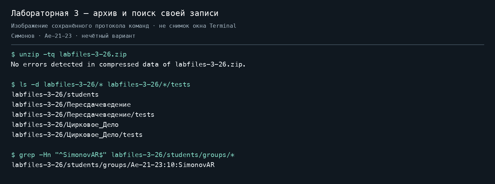
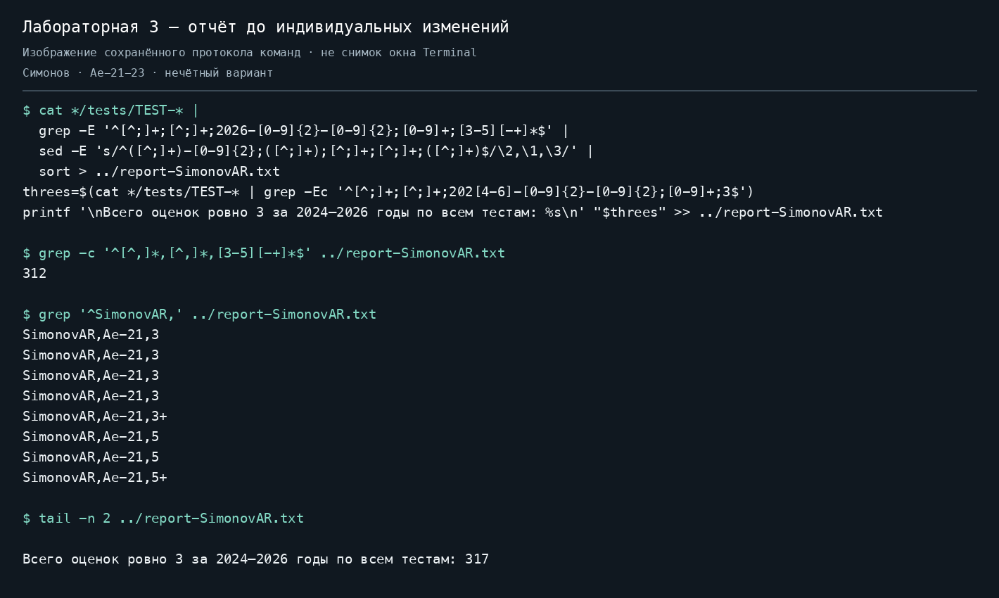
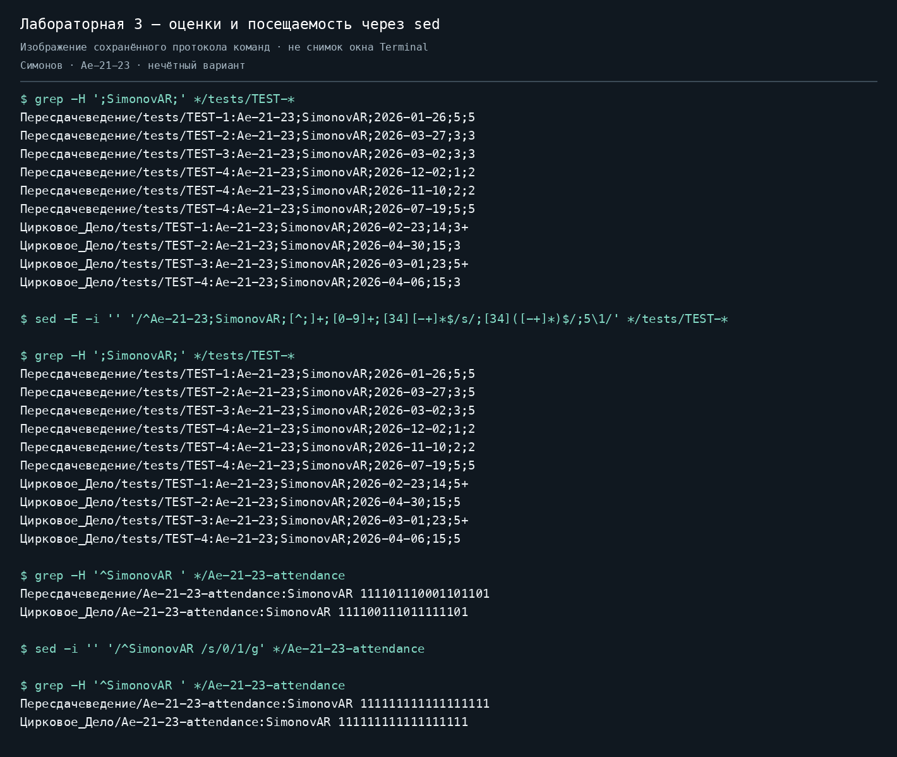
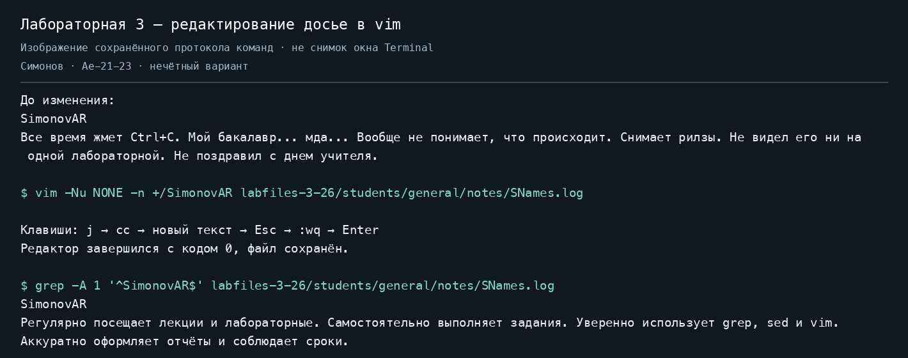
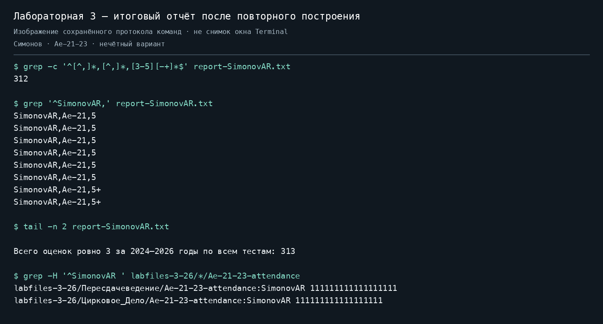

# Лабораторная работа 3

Симонов Антон Романович, группа АЭ-21. В учебных файлах: `SimonovAR`, группа `Ae-21-23`.
В фамилии «Симонов» 7 букв, поэтому выполнен **нечётный вариант**.

Работа выполнена по [заданию](ASSIGNMENT.md) на macOS через терминал, без `awk`.
Исходный [учебный архив опубликован преподавателем](https://github.com/dmieter/os-labs/blob/main/labs-2026/lab3/labfiles-3-26.zip) в открытом репозитории. Git blob SHA исходного ZIP и приложенной копии совпадает: `24ec27f1f27b206c90e6a010369832a08e56783a`. Все изменения относительно архива ограничены собственными учебными записями.
Преподаватель в рамках учебного сюжета строгий: проверяет точность отчёта, посещаемость и оформление.

Итог: [отчёт](report-SimonovAR.txt) содержит **312 успешных попыток за 2026 год** по двум предметам и **313 оценок ровно 3 за 2024–2026 годы** после индивидуальных изменений. Исправленные учебные файлы находятся в `labfiles-3-26/`, исходные — в ZIP.

## 1 Распаковка архива

```bash
unzip labfiles-3-26.zip
cd labfiles-3-26
ls
```

`unzip` распаковывает архив в текущую директорию; `cd` переходит в извлечённую папку; `ls` показывает содержимое: `Цирковое_Дело`, `Пересдачеведение`, `students`.

В опубликованной папке уже лежит готовый результат. Для повторения с начала распакуйте ZIP в отдельную пустую рабочую папку, чтобы сохранить выполненные изменения.

Найдём свою запись и посмотрим результаты:

```bash
grep -Hn '^SimonovAR$' students/groups/*
grep -Hn ';SimonovAR;' */tests/TEST-*
```

`*` разворачивается оболочкой в подходящие имена файлов. `grep` ищет совпадения; `-H` выводит имя файла, `-n` — номер строки. `^` означает начало строки, `$` — конец. Первый поиск находит точный идентификатор, второй — второе поле CSV между разделителями `;`.

У каждого предмета четыре файла `tests/TEST-N`. Строка содержит пять полей:

```text
группа;ФИО;дата;количество правильных ответов;оценка
Ae-21-23;SimonovAR;2026-03-27;3;3
```

Год набора в группе (`23`) и год сдачи теста (`2026`) — разные значения.

## 2 Основной отчёт до индивидуальных изменений

Команды этого раздела и пунктов 3.1–3.2 выполняются внутри `labfiles-3-26`.

```bash
cat */tests/TEST-* |
  grep -E '^[^;]+;[^;]+;2026-[0-9]{2}-[0-9]{2};[0-9]+;[3-5][-+]*$' |
  sed -E 's/^([^;]+)-[0-9]{2};([^;]+);[^;]+;[^;]+;([^;]+)$/\2,\1,\3/' |
  sort > ../report-SimonovAR.txt
```

- `cat` объединяет все восемь файлов; `|` передаёт вывод следующей команде.
- `grep -E` включает расширенные регулярные выражения и оставляет успешные попытки за 2026 год.
- `[^;]+` означает один или несколько символов, кроме `;`: одно непустое поле.
- `2026-[0-9]{2}-[0-9]{2}` выбирает год из третьего поля.
- `[3-5][-+]*` допускает оценки 3–5 и суффиксы: `3+`, `4--`, `5++`.
- `sed -E` преобразует строку. Скобки запоминают группу без года, ФИО и оценку. `\2,\1,\3` выводит их в порядке «ФИО, группа, оценка». Остальные поля отбрасываются.
- `sort` сортирует. `sort -u` здесь не применяется: одинаковые строки могут относиться к разным тестам, и все попытки должны сохраниться.
- `>` создаёт или перезаписывает файл. `..` обозначает родительскую директорию.

Добавим сводку нечётного варианта:

```bash
threes=$(cat */tests/TEST-* |
  grep -Ec '^[^;]+;[^;]+;202[4-6]-[0-9]{2}-[0-9]{2};[0-9]+;3$')
printf '\nВсего оценок ровно 3 за 2024–2026 годы по всем тестам: %s\n' "$threes" \
  >> ../report-SimonovAR.txt
```

`202[4-6]` охватывает 2024, 2025 и 2026 годы. `grep -c` считает совпавшие строки. `;3$` требует именно последнее поле `3`: `3+` сюда не входит, поскольку в задании указано `оценка == 3`. `$(...)` сохраняет вывод в переменную, `printf` подставляет число вместо `%s`, а `>>` дописывает сводку.

Проверка:

```bash
grep -c '^[^,]*,[^,]*,[3-5][-+]*$' ../report-SimonovAR.txt
grep '^SimonovAR,' ../report-SimonovAR.txt
tail -n 2 ../report-SimonovAR.txt
```

До изменений: **312 строк попыток**, по 156 на предмет, **317 троек**. Всего строк 314: 312 попыток, пустая строка и сводка. `tail -n 2` показывает последние две строки. Сводка находится в том же файле по требованию задания, поэтому файл имеет расширение `.txt`.

## 3 Индивидуальное задание

### 3.1 Итоговые положительные оценки через sed

```bash
sed -E -i '' \
  '/^Ae-21-23;SimonovAR;[^;]+;[0-9]+;[34][-+]*$/s/;[34]([-+]*)$/;5\1/' \
  */tests/TEST-*

grep -H ';SimonovAR;' */tests/TEST-*
```

`-i ''` — синтаксис macOS: сохранить изменения в файлах без резервной копии. Исходники доступны в ZIP. На Linux с GNU sed вместо `-i ''` используется `-i`.

Адрес `/^Ae-21-23;SimonovAR;...$/` ограничивает обработку собственными положительными оценками 3 или 4. Операция `s/старое/новое/` меняет последнее поле на 5. Группа `([-+]*)` и ссылка `\1` сохраняют суффикс: `3+` становится `5+`.

В этих данных у студента одна успешная попытка на тест, поэтому она является итоговой. Среди собственных записей есть неудачные попытки с датами позже успешной; итоговую положительную запись выбираем по оценке, а не по максимальной дате. Свои две неудачные попытки с оценкой 2 оставлены согласно нечётному варианту. Уже выставленные 5 и 5+ сохранены. Поля даты, группы и количества ответов не менялись.

Всего повышены пять оценок: две в «Пересдачеведении» и три в «Цирковом деле».

### 3.2 Посещаемость через sed

```bash
grep -H '^SimonovAR ' */Ae-21-23-attendance
sed -i '' '/^SimonovAR /s/0/1/g' */Ae-21-23-attendance
grep -H '^SimonovAR ' */Ae-21-23-attendance
```

Адрес `/^SimonovAR /` выбирает свою строку. `s/0/1/g` заменяет все нули единицами: `g` означает все совпадения в выбранной строке. В обоих файлах получено:

```text
SimonovAR 111111111111111111
```

### 3.3 Досье через vim

Перейдём из `labfiles-3-26` обратно в корень проекта и откроем досье:

```bash
cd ..
vim -Nu NONE -n +/SimonovAR labfiles-3-26/students/general/notes/SNames.log
```

`-Nu NONE` запускает Vim без пользовательских настроек, `-n` отключает swap-файл, `+/SimonovAR` сразу ищет запись. Редактирование выполнено в интерактивном Vim.

Последовательность клавиш:

1. `j` — перейти с фамилии на следующую строку с характеристикой.
2. `cc` — заменить строку и перейти в режим ввода.
3. Ввести новую характеристику:

   ```text
   Регулярно посещает лекции и лабораторные. Самостоятельно выполняет задания. Уверенно использует grep, sed и vim. Аккуратно оформляет отчёты и соблюдает сроки.
   ```

4. `Esc` — вернуться в командный режим.
5. `:wq` и `Enter` — сохранить файл и выйти.

Проверка:

```bash
grep -A 1 '^SimonovAR$' labfiles-3-26/students/general/notes/SNames.log
```

`-A 1` показывает одну строку после совпадения. У других студентов заметки сохранены.

### 3.4 Обновление отчёта

После исправления исходников повторно выполнены команды пункта 2. Для пересборки из корня проекта есть скрипт с теми же командами:

```bash
bash build-report.sh
grep '^SimonovAR,' report-SimonovAR.txt
tail -n 2 report-SimonovAR.txt
```

| Показатель | Результат |
| --- | --- |
| Успешные попытки за 2026 год | 312 |
| Студенты в отчёте | 39 |
| Тесты | 8, по 4 на предмет |
| Собственные оценки в отчёте | шесть 5 и две 5+ |
| Тройки за 2024–2026 годы до изменений | 317 |
| Тройки за 2024–2026 годы после изменений | 313 |
| Собственная посещаемость | 18 единиц по каждому предмету |

Троек стало на четыре меньше: повышение `3+` не влияет на подсчёт точного значения `3`. Сравнение с архивом подтвердило изменения восьми файлов: пяти тестов, двух ведомостей посещаемости и одного файла заметок. Остальные строки и поля сохранены.

## 4 GitHub и материалы выполнения

Результат размещён в отдельном открытом репозитории [asimonov05/os-lab3-simonov](https://github.com/asimonov05/os-lab3-simonov).

Команды загрузки из корня проекта:

```bash
git init -b main
git add .
git commit -m "Complete OS lab 3 for SimonovAR"
git remote add origin https://github.com/asimonov05/os-lab3-simonov.git
git push -u origin main
```

`git init` создаёт локальный репозиторий с веткой `main`. `git add` готовит файлы к коммиту. `git commit` сохраняет версию. `git remote add` связывает проект с предварительно созданным репозиторием GitHub. `git push -u` загружает коммит и связывает ветки для следующих загрузок.

Фактические команды и вывод сохранены в [evidence](evidence/). Ниже приложены изображения этих протоколов. Они не являются снимками окна Terminal: доступ к окнам компьютера во время выполнения был недоступен. Для буквального выполнения требования о скриншотах нужно дополнительно снять окно терминала при демонстрации основных этапов.







Сообщение преподавателю и очная защита остаются действиями студента. Текст для сообщения:

```text
Лабораторная работа 3 готова. Симонов Антон, АЭ-21, нечётный вариант.
https://github.com/asimonov05/os-lab3-simonov
```

## Команды для защиты

```bash
# Свои попытки с именами файлов и номерами строк.
grep -Hn ';SimonovAR;' labfiles-3-26/*/tests/TEST-*

# Неудачные попытки за 2026 год. -h скрывает имена файлов.
grep -Eh '^[^;]+;[^;]+;2026-[^;]+;[0-9]+;2[-+]*$' \
  labfiles-3-26/*/tests/TEST-*

# Замена sed без изменения файла: отсутствует -i.
printf '%s\n' 'Ae-21-23;SimonovAR;2026-03-27;3;3+' |
  sed -E '/^Ae-21-23;SimonovAR;/s/;[34]([-+]*)$/;5\1/'

# Тренировка Vim на копии.
cp labfiles-3-26/students/general/notes/SNames.log /tmp/SNames-practice.log
vim +/SimonovAR /tmp/SNames-practice.log
```

Vim: `/шаблон` — поиск, `n` — следующее совпадение, `j`/`k` — вниз/вверх, `i` — ввод, `cc` — замена строки, `u` — отмена, `Esc` — командный режим, `:w` — сохранение, `:q` — выход, `:q!` — выход без сохранения, `:wq` — сохранение и выход.
